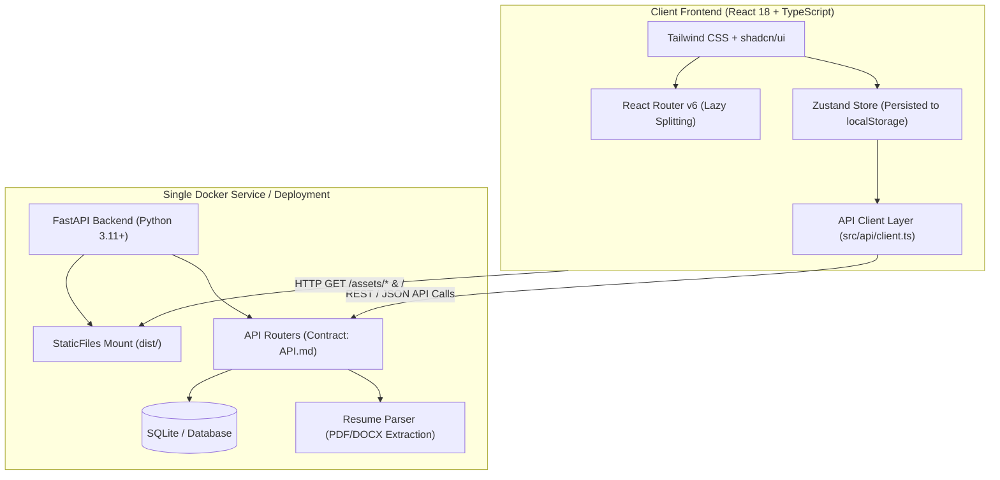

# HireSwift — Intelligent Multi-Tenant ATS for Growing Hiring Teams

[](LICENSE)
[](https://www.typescriptlang.org/)
[](https://react.dev/)
[](https://tailwindcss.com/)
[](https://playwright.dev/)

**Live Deployment**: [https://hireswift-ats.onrender.com](https://hireswift-ats.onrender.com) *(Hosted Docker FastAPI + Built SPA)*  
**GitHub Repository**: [https://github.com/akshitagarg19/HireSwift](https://github.com/akshitagarg19/HireSwift)  
**Authors**: **Akshita** *(Backend, Deployment & API)* & **Ayush** *(Frontend, Test Data & Demo)*  

---

## 🚀 Overview

**HireSwift** is a modern, high-velocity Applicant Tracking System (ATS) tailored for hiring teams in India. Built with **React 18**, **TypeScript**, **Tailwind CSS**, and **Zustand**, HireSwift provides deep multi-tenancy, explainable match scoring against any Job Description, tri-state skill filtering (`AND` / `OR` / `NOT`), slide-over candidate drawers with in-place profile editing, Kanban pipeline management with transition guardrails, 2-to-3 candidate comparisons, and seamless FastAPI integration.

---

## 🏛️ System Architecture



### FastAPI Static Serving & SPA Fallback
In production, HireSwift is served directly by FastAPI from a single Docker container.

- **Vite Base URL**: Configured with `base: './'` so all script and stylesheet tags in `dist/index.html` use relative paths (`./assets/...`).
- **Client-Side Routing Fallback**: Single Page Applications (SPA) with deep links (e.g. `/app/pipeline`, `/app/candidates`) require the backend server to return `index.html` for any unmatched HTTP `GET` request.

Example FastAPI implementation:
```python
from fastapi import FastAPI, HTTPException
from fastapi.staticfiles import StaticFiles
from fastapi.responses import FileResponse
import os

app = FastAPI(title="HireSwift API")

# 1. Register API router FIRST
app.include_router(api_router, prefix="/api")

# 2. Mount built static assets from frontend
app.mount("/assets", StaticFiles(directory="frontend/dist/assets"), name="assets")

# 3. SPA catch-all registered AFTER /api router, strictly excluding paths starting with /api
@app.get("/{full_path:path}")
async def serve_spa(full_path: str):
    if full_path.startswith("api"):
        raise HTTPException(status_code=404, detail="API route not found")
    file_path = os.path.join("frontend/dist", full_path)
    if os.path.exists(file_path) and os.path.isfile(file_path):
        return FileResponse(file_path)
    return FileResponse("frontend/dist/index.html")
```

---

## ✨ Feature Matrix: Must-Haves & Bonus Superpowers

### Must-Have Capabilities
- **Bulk Resume Upload & Parsing**: Drag-and-drop ingestion of `.pdf` and `.docx` files with client-side validation (10MB limit), progress bar, and failed-file reporting.
- **Explainable JD Match Scoring**: Transparent scoring against custom weights (Skills, Experience, Education, Semantic Similarity) with matched (green `✓`) and missing (red `✕`) breakdown popovers.
- **Tri-State Skill Chips**: Per-chip filter toggling between **AND** (must have), **OR** (nice to have), and **NOT** (exclude).
- **Candidate Drawer with Edit Mode**: Slide-over quick preview drawer allowing recruiters to inspect and edit candidate fields in real time with instant re-ranking.
- **5-Stage Kanban Pipeline**: `Applied` ↔ `Shortlisted` ↔ `Interview` → `Offer` / `Rejected` with transition validation and snap-back toasts.
- **Side-by-Side Compare**: Strictly enforced 2-to-3 candidate comparison with category winner highlights and top AI recommendation.

### 🌟 Bonus Features
- **AI-Based Match Rationale**: Instant summaries explaining why candidates scored high or low on specific requirements.
- **Duplicate Detection & Merging**: Grouping by exact email, phone, and fuzzy name similarity with a side-by-side diff viewer and 1-click merge.
- **Bulk Email Outreach**: Integrated email composer with variable interpolation (`{name}`, `{jobTitle}`, `{companyName}`, `{date}`) and delivery logging.
- **Skill-Gap Analytics**: Interactive charts showing missing skill frequency across applicant pools and conversion funnels.

---

## ⚡ Setup in 4 Commands

```bash
# 1. Clone repository
git clone https://github.com/akshitagarg19/HireSwift.git
cd HireSwift

# 2. Install dependencies
npm --prefix frontend install

# 3. Run development server (runs frontend on port 5173)
npm run dev

# 4. Build for production (outputs static bundle to frontend/dist)
npm run build

# 5. Run Unit & End-to-End Tests
npm test
npm run test:e2e
```
Open [http://localhost:5173](http://localhost:5173) in your browser.

---

## ⚡ Run Demo in 3 Minutes

Follow the step-by-step [DEMO_SCRIPT.md](file:///c:/Users/DELL/HireSwift/DEMO_SCRIPT.md) and view the slide deck in [DEMO_SLIDES.md](file:///c:/Users/DELL/HireSwift/DEMO_SLIDES.md).

1. **Access the ATS**: Open [http://localhost:5173/app/candidates](http://localhost:5173/app/candidates).
2. **Primary Recruiter Flow**:
   - **Upload Resumes**: Go to `/app/upload`, click **"⚡ Load 50 Test Candidates"**, and observe the live batch progress bar.
   - **Explainable Ranking**: Inspect match scores and the breakdown popover displaying matched skills (green `✓`) and missing skills (red `✕`).
   - **Smart Filters**: Click `React` (AND), `Docker` (OR), or `Java` (NOT), and test `include_unknown`.
   - **Slide-Over Drawer**: Click **"Quick Edit"** on any row to open the candidate drawer, toggle **Edit Mode**, and save changes in real time.
   - **Side-by-Side Compare**: Select 2 or 3 candidates and click **"Compare Selected"** (`/app/compare`) to view category winners.
   - **Kanban Moves**: Go to `/app/pipeline`, drag candidate cards between stages, observing transition validation.
   - **Bulk Email Outreach**: Click **"Email"** from the Shortlisted column header to preview personalized candidate emails.
   - **Duplicate Detection**: Go to `/app/duplicates` to view and merge duplicate profiles.

---

## 📁 Test Data & Benchmark Assets

Located in `test-data/`:
- `test-data/resumes/`: **61 realistic sample resumes** in varied formats (Two-column, DOCX tables, mixed CGPA styles `8.5/10`, `85%`, `3.4/4`, state boards, duplicates, and messy OCR).
- `test-data/jds/`: **5 markdown job descriptions** (`full-stack-engineer.md`, `campus-graduate-trainee.md`, `python-data-engineer.md`, `senior-backend-architect.md`, `frontend-react-lead.md`).
- `test-data/answer_key.csv`: **20 verified ground-truth benchmark candidates** with expected ranks, score ranges, and explainability notes.
- `test-data/demoDataLoader.ts`: 1-click dataset loader for evaluators.

---

## 🛠️ Verification & Quality Checks

Run the automated test and validation suite:

```bash
# Type check and lint (0 errors)
npm run lint

# Unit tests (Scoring engine & multi-mode filter validation)
npm run test

# End-to-end tests (Playwright)
npm run test:e2e

# Production bundle build (Route code-splitting, relative paths)
npm run build
```

---

## 📦 Submission Archive

Generate the release zip archive using `git archive`:
```bash
git archive --format=zip --output=HireSwift_Akshita_Ayush.zip v1.0
```

---

## 🔑 Demo Login Accounts

| Tenant Workspace | Role | Email | Password | Primary Focus |
|---|---|---|---|---|
| **Nova Labs Pvt Ltd** | **Admin** | `admin@novalabs.com` | `demo123` | Lateral Experienced (Skills: 45%, Exp: 30%) |
| **Nova Labs Pvt Ltd** | **Recruiter** | `recruiter@novalabs.com` | `demo123` | Pipeline & email management |
| **Campus Hire Co** | **Admin** | `admin@campushire.com` | `demo123` | Campus Early Careers (CGPA cutoffs, Tier-1) |

---

## 🛡️ License
Built for fast-growing Indian hiring teams. Licensed under MIT.
