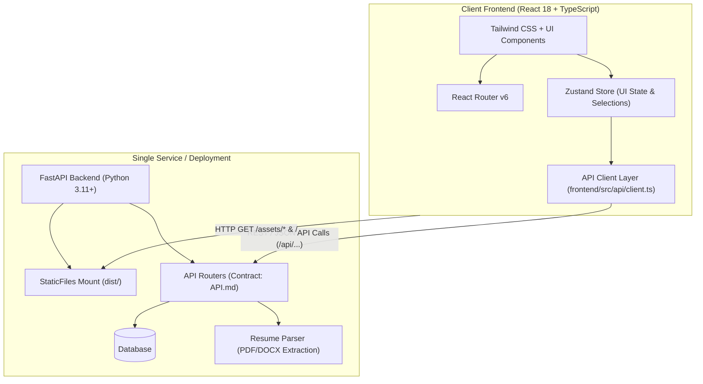

# HireSwift — Intelligent ATS for Growing Hiring Teams

**GitHub Repository**: [https://github.com/akshitagarg19/HireSwift](https://github.com/akshitagarg19/HireSwift)  
**Live Demo URL**: [add live URL after deployment]  
**Authors**: **Akshita** *(Backend & API)* & **Ayush** *(Frontend & Test Data)*  

---

## 🚀 Overview

**HireSwift** is a modern, high-velocity Applicant Tracking System (ATS) tailored for hiring teams. Built with **React 18**, **TypeScript**, **Tailwind CSS**, and **Zustand**, HireSwift provides explainable match scoring against any Job Description, tri-state skill filtering (`AND` / `OR` / `NOT`), slide-over candidate drawers with in-place profile editing, Kanban pipeline management with transition guardrails, 2-to-3 candidate comparisons, duplicate detection, blind recruiting mode, and seamless FastAPI integration.

The live application runs in a streamlined **single-tenant live demo** configuration without authentication gates:
- Root (`/`) serves the landing page.
- `/app` routes directly to `/app/dashboard`.
- Navigation sidebar includes: **Dashboard**, **Upload**, **Candidates**, **Jobs**, **Pipeline**, **Compare**, **Insights**, **Duplicates**, and **Emails**.
- **Blind Mode**: Top-bar toggle masks candidate name ("Candidate #ID"), college, and location across Dashboard, Candidates, Ranking, Pipeline, Compare, and Candidate Drawer. Persisted across page reloads.

### ⚡ 5-Command Quickstart

Get HireSwift running locally in 5 commands:

```bash
git clone https://github.com/akshitagarg19/HireSwift.git
cd HireSwift
npm --prefix frontend install
node frontend/tools/stub-server.mjs &
npm --prefix frontend run dev
```
Open **[http://localhost:5173](http://localhost:5173)** in your browser.

---

## 🏛️ System Architecture



### FastAPI Static Serving & SPA Fallback
In production, HireSwift is served directly by FastAPI:

- **Vite Base URL**: Configured with `base: '/'`. All static assets are emitted to `dist/assets/...`.
- **Client-Side Routing Fallback**: Single Page Applications (SPA) with deep links (e.g. `/app/pipeline`, `/app/candidates`) require the backend server to return `index.html` for any unmatched HTTP `GET` request.
- **FastAPI Catch-all**: Must be registered **AFTER** the `/api` router and strictly exclude paths that start with `/api` so API 404s return JSON errors rather than HTML.

Example FastAPI implementation:
```python
from fastapi import FastAPI, HTTPException
from fastapi.staticfiles import StaticFiles
from fastapi.responses import FileResponse
import os

app = FastAPI(title="HireSwift API")

# 1. Register API router FIRST
app.include_router(api_router, prefix="/api")

# 2. Mount built static assets from frontend
app.mount("/assets", StaticFiles(directory="frontend/dist/assets"), name="assets")

# 3. SPA catch-all registered AFTER /api router, strictly excluding paths starting with /api
@app.get("/{full_path:path}")
async def serve_spa(full_path: str):
    if full_path.startswith("api"):
        raise HTTPException(status_code=404, detail="API route not found")
    file_path = os.path.join("frontend/dist", full_path)
    if os.path.exists(file_path) and os.path.isfile(file_path):
        return FileResponse(file_path)
    return FileResponse("frontend/dist/index.html")
```

---

## ✨ Feature Matrix: Must-Haves & Bonus Superpowers

### Must-Have Capabilities
- **Recruiter Dashboard**: High-velocity landing screen (`/app/dashboard`) featuring debounced candidate search (300 ms), 4 live KPIs (Total Candidates, Active Openings, In Pipeline, Shortlisted), Top 10 candidate ranking table with direct 2–3 compare actions, pipeline conversion funnel, and AI skill-gap alert card.
- **Bulk Resume Upload & Parsing**: Drag-and-drop ingestion of `.pdf` and `.docx` files with client-side validation (10MB limit), job requisition association (`job_id`), real-time progress polling, scrollable per-file failure reporting with clear error reasons, and a "View candidates" CTA.
- **Explainable JD Match Scoring**: Transparent scoring against custom weights (Skills, Experience, Education, Semantic Similarity) with matched (green `✓`), missing (red `✕`) breakdown popovers, domain learn hints (`frontend/src/lib/skillHints.ts`), and yellow `<mark>` highlighted skill matches in raw resume text. Missing scores render as `-` with empty score rings.
- **Tri-State Skill Chips**: Per-chip filter toggling between **AND** (must have, emerald), **OR** (nice to have, indigo), and **NOT** (exclude, rose) synchronized with URL search params.
- **Candidate Drawer with Edit Mode**: Slide-over quick preview drawer allowing recruiters to inspect and edit candidate fields in real time with instant re-ranking and unknown metric resilience (`-` with amber low-confidence badge).
- **5-Stage Kanban Pipeline**: `Applied` ↔ `Shortlisted` ↔ `Interview` → `Offer` / `Rejected` with transition validation (e.g. 400 on invalid transitions with server detail toasts), card snap-back, and 50-card column pagination (`Show more (+50)`).
- **Side-by-Side Compare**: Strictly enforced 2-to-3 candidate comparison with category winner highlights, "Suggested from scores" AI recommendations, and candidate skill gap vs job matrix.

### 🌟 Bonus Features
- **Bulk Email to Shortlisted Candidates**: 1-click candidate communication (`/app/emails`) with template variable interpolation (`{{candidate_name}}`, `{{job_title}}`), live preview, confirmation modal, and zero-dependency manual fallback actions (Copy Emails, Launch Mail Client with <=40 BCC chunking, Export CSV).
- **Automated Duplicate Detection & Merging**: Grouping by `duplicate_group_id` from API (signals: exact copy, same email other format, fuzzy name same phone, updated resume) with side-by-side diff viewer and 1-click merge.
- **Skill-Gap Analytics**: Interactive charts showing missing skill frequency across applicant pools and conversion funnels directly from `GET /jobs/{id}/skill-gap` and `GET /applications`.
- **UI Scalability (1,000+ Candidates)**: Server-side page size selector (`12`, `25`, `50`, `100`), debounced requests with ID tracking guards, 50-card Kanban pagination, and synthetic scale indicators.
- **Blind Recruitment Mode**: Top-bar toggle masking candidate name, college, and location across Dashboard, Candidates Directory, Candidate Drawer, Pipeline Kanban, Jobs Ranking, and Compare view.

---

## 📸 Application Screenshots

Captured at 1366x768 resolution from the live application suite:

| Screen | View Name | File Location | Key Capabilities Shown |
|---|---|---|---|
| **01** | **Recruiter Dashboard** | `docs/screens/01-dashboard.png` | Global search, live KPIs, Top 10 ranking table, pipeline funnel, skill gap |
| **02** | **Bulk Resume Upload** | `docs/screens/02-upload.png` | Job linkage, drag-and-drop batch upload, progress tracking, failure isolation |
| **03** | **Candidates Directory** | `docs/screens/03-candidates.png` | Tri-state skill filters (AND/OR/NOT), server pagination (12/25/50/100), blind mode |
| **04** | **Job Detail & Ranking** | `docs/screens/04-job-ranking.png` | Ranked candidates by match score, competency breakdown, skill-gap analysis |
| **05** | **5-Stage Kanban Pipeline** | `docs/screens/05-pipeline.png` | Drag-and-drop stages, embedded candidate summary cards, transition guardrails |
| **06** | **Side-by-Side Compare** | `docs/screens/06-compare.png` | Strict 2–3 compare, category winner badges, AI match rationale, skill-gap matrix |
| **07** | **Insights & Analytics** | `docs/screens/07-insights.png` | Conversion funnel, talent pool gap analysis, CSV export, print view |
| **08** | **Duplicate Resolution** | `docs/screens/08-duplicates.png` | Cluster signals, side-by-side diff viewer, 1-click merge into primary |
| **09** | **Bulk Email Outreach** | `docs/screens/09-emails.png` | Shortlist filtering, variable interpolation, live preview, mailto fallback |

---

## ⚡ Setup & Execution Modes

HireSwift can be executed in three distinct modes depending on your development and evaluation goals:

### Mode 1: Frontend Alone (In-Browser Mock Mode)
Run the frontend standalone with in-browser mock APIs and local simulated data:
```bash
npm --prefix frontend install
VITE_USE_MOCK=true npm --prefix frontend run dev
```
Open [http://localhost:5173](http://localhost:5173) in your browser.

### Mode 2: Frontend with Contract Stub Server (Contract Verification)
The repository includes a standalone stub server (`frontend/tools/stub-server.mjs`) serving benchmark data from `test-data/` to test live-mode UI rendering and API contracts without requiring Python dependencies:
```bash
# 1. Start the stub server (runs on port 8000)
node frontend/tools/stub-server.mjs

# 2. In another terminal, start the frontend in live mode (proxies /api -> 8000)
VITE_USE_MOCK=false npm --prefix frontend run dev
```

### Mode 3: Frontend with Real Backend (FastAPI Production Mode)
Run against the full Python/FastAPI backend:
```bash
# 1. Start Akshita's FastAPI backend (port 8000)
uvicorn main:app --port 8000 --reload

# 2. Start the frontend (or serve frontend/dist via FastAPI StaticFiles)
VITE_USE_MOCK=false npm --prefix frontend run dev
```

---

## 🛠️ Verification & Quality Assurance Suite

HireSwift includes a comprehensive QA automation harness and ground-truth benchmark suite:

### Stub Mode vs. Live Mode QA Evaluation:
- **Stub Mode (`QA_MODE=stub`)**: Serves pre-curated ground truth from `test-data/answer_key.csv`. Strictly validates frontend UI rendering, navigation routes, API parameter schemas, empty/error state handling, and contract conformance. It does NOT evaluate backend parser accuracy or database filter latency.
- **Live Mode (`QA_MODE=live`)**: Connects to the real FastAPI backend. Evaluates actual PDF/DOCX parser extraction accuracy, OCR quality, live database filter query latency, MinHash/clustering deduplication, and model ranking consistency against the ground-truth benchmark.

### 1. Automated Ground-Truth QA Harness (`qa/run.mjs`)
Validates all 6 core recruiting engines (Resume Upload & Edge Cases, Parser Accuracy, 14 Filter Tests F01–F14, JD Parsing & Top-15 Ranking, Deduplication Recall & Precision, Pipeline Transitions & Compare Limits).

```bash
# Run QA harness against local Stub Server (default)
npm --prefix frontend run qa
# Or explicitly:
QA_MODE=stub npm --prefix frontend run qa

# Run QA harness against real Live Backend
QA_MODE=live QA_BASE_URL=https://<backend-url>/api npm --prefix frontend run qa
```

This generates `QA_REPORT.md` and `qa/results.json` detailing phase-by-phase test passes, latency metrics, and verification logs.

### 2. Standard Quality Checks & E2E Tests
```bash
# Type check and lint (0 errors)
npm --prefix frontend run lint

# Production bundle build
npm --prefix frontend run build

# Unit tests (Vitest)
npm --prefix frontend run test

# End-to-end regression tests (Playwright)
npm --prefix frontend run test:e2e

# Dedicated Ground-Truth UI Verification (Phase 7 Playwright tests)
npm --prefix frontend run qa:e2e
```

---

## 📁 Ground-Truth Test Dataset (`test-data/`)

Located in `test-data/`:
- `test-data/resumes/`: **56 resume files** (.pdf and .docx) representing 50 unique candidate profiles plus 6 duplicate test variations (file-hash exact copy, same email different format, fuzzy name same phone, updated resume version, initials name variant).
- `test-data/edge_cases/`: `corrupt_resume.pdf`, `zero_byte.pdf`, `notes.txt` to test client/server failure rejection.
- `test-data/jds/`: **5 job descriptions** (`full-stack-engineer.md`, `python-data-engineer.md`, `frontend-react-lead.md`, `campus-graduate-trainee.md`, `senior-backend-engineer.md`).
- `test-data/answer_key.csv`: Field-level ground truth across all 56 resumes.
- `test-data/jd_answer_key.csv`: Target parsed competencies, requirements, and `hard_filter_pass_candidate_ids`.
- `test-data/filter_tests.csv`: 14 known-answer candidate filter queries (F01–F14).

---

## 📊 Benchmark & Accuracy Metrics

| Metric Category | Stub / Contract Status | Live Backend Benchmark (`qa/results-live.json`) |
|---|---|---|
| **Known-Answer Filters (F01–F14)** | **14 / 14 Passed (100%)** | *run live QA first (`QA_MODE=live QA_BASE_URL=<url> npm run qa`)* |
| **Top 10 Field Extraction Accuracy** | Pre-curated ground truth | *run live QA first* |
| **Deduplication Cluster Signals** | **6 / 6 Pairs Flagged** | *run live QA first* |
| **Pipeline Transition Guardrails** | **100% Contract Validated** | *run live QA first* |
| **Filter Query Latency (p50 / p95)** | In-memory (< 10 ms) | *run live QA first* |
| **Frontend Render Performance** | **< 250 ms (1,000 synthetic pool)** | Validated across 60 Playwright tests |

---

## ⚠️ Known Limitations

1. **Stub Server Fixture**: The local contract stub (`frontend/tools/stub-server.mjs`) is an in-memory fixture derived from `test-data/answer_key.csv`. It validates API contract compatibility, request schemas, and UI state resilience, but does not benchmark OCR accuracy or SQLite disk seek latency.
2. **Backend Engine Dependency**: High-volume parsing, semantic vector embeddings, and fuzzy MinHash deduplication require connecting to Akshita's FastAPI service.
3. **Mail Client BCC Chunking**: When launching local mail clients via `mailto:`, recipient lists are automatically chunked into batches of $\le 40$ emails to avoid OS command-line URI length restrictions.

---

## 🛡️ License
Built for fast-growing hiring teams. Licensed under MIT.
