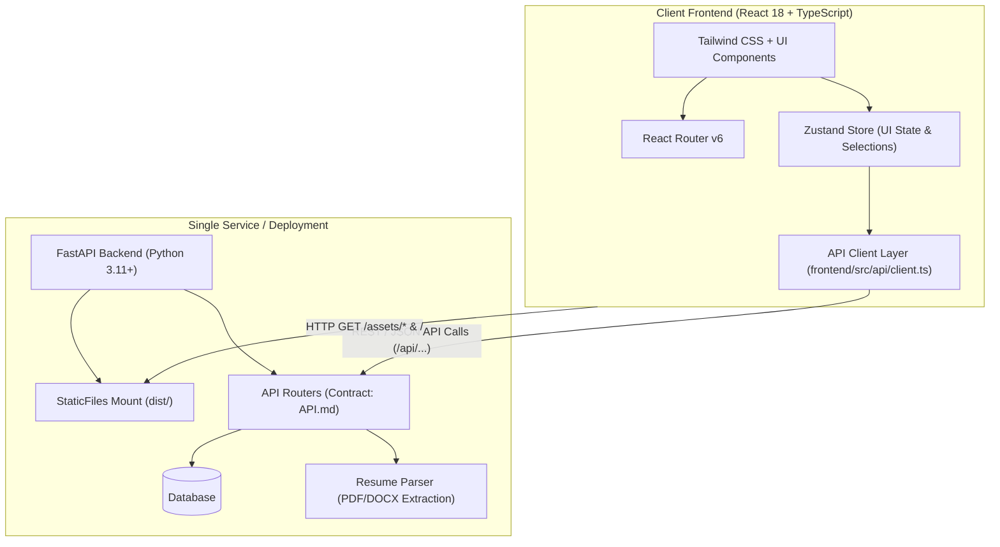

# HireSwift — Intelligent ATS for Growing Hiring Teams

**GitHub Repository**: [https://github.com/akshitagarg19/HireSwift](https://github.com/akshitagarg19/HireSwift)  
**Authors**: **Akshita** *(Backend & API)* & **Ayush** *(Frontend & Test Data)*  

---

## 🚀 Overview

**HireSwift** is a modern, high-velocity Applicant Tracking System (ATS) tailored for hiring teams. Built with **React 18**, **TypeScript**, **Tailwind CSS**, and **Zustand**, HireSwift provides explainable match scoring against any Job Description, tri-state skill filtering (`AND` / `OR` / `NOT`), slide-over candidate drawers with in-place profile editing, Kanban pipeline management with transition guardrails, 2-to-3 candidate comparisons, duplicate detection, blind recruiting mode, and seamless FastAPI integration.

The live application runs in a streamlined **single-tenant live demo** configuration without authentication gates:
- Root (`/`) serves the landing page.
- `/app` routes directly to `/app/upload`.
- Navigation sidebar includes: **Upload**, **Candidates**, **Jobs**, **Pipeline**, **Compare**, **Insights**, **Duplicates**, and **Emails**.
- **Blind Mode**: Top-bar toggle masks candidate name ("Candidate #ID"), college, and location across Candidates, Ranking, Pipeline, Compare, and Candidate Drawer. Persisted across page reloads.

---

## 🏛️ System Architecture



### FastAPI Static Serving & SPA Fallback
In production, HireSwift is served directly by FastAPI:

- **Vite Base URL**: Configured with `base: '/'`. All static assets are emitted to `dist/assets/...`.
- **Client-Side Routing Fallback**: Single Page Applications (SPA) with deep links (e.g. `/app/pipeline`, `/app/candidates`) require the backend server to return `index.html` for any unmatched HTTP `GET` request.
- **FastAPI Catch-all**: Must be registered **AFTER** the `/api` router and strictly exclude paths that start with `/api` so API 404s return JSON errors rather than HTML.

Example FastAPI implementation:
```python
from fastapi import FastAPI, HTTPException
from fastapi.staticfiles import StaticFiles
from fastapi.responses import FileResponse
import os

app = FastAPI(title="HireSwift API")

# 1. Register API router FIRST
app.include_router(api_router, prefix="/api")

# 2. Mount built static assets from frontend
app.mount("/assets", StaticFiles(directory="frontend/dist/assets"), name="assets")

# 3. SPA catch-all registered AFTER /api router, strictly excluding paths starting with /api
@app.get("/{full_path:path}")
async def serve_spa(full_path: str):
    if full_path.startswith("api"):
        raise HTTPException(status_code=404, detail="API route not found")
    file_path = os.path.join("frontend/dist", full_path)
    if os.path.exists(file_path) and os.path.isfile(file_path):
        return FileResponse(file_path)
    return FileResponse("frontend/dist/index.html")
```

---

## ✨ Feature Matrix: Must-Haves & Bonus Superpowers

### Must-Have Capabilities
- **Bulk Resume Upload & Parsing**: Drag-and-drop ingestion of `.pdf` and `.docx` files with client-side validation (10MB limit), real-time progress polling, per-file failure reporting with clear error reasons, and a "View candidates" CTA.
- **Explainable JD Match Scoring**: Transparent scoring against custom weights (Skills, Experience, Education, Semantic Similarity) with matched (green `✓`) and missing (red `✕`) breakdown popovers.
- **Tri-State Skill Chips**: Per-chip filter toggling between **AND** (must have), **OR** (nice to have), and **NOT** (exclude).
- **Candidate Drawer with Edit Mode**: Slide-over quick preview drawer allowing recruiters to inspect and edit candidate fields in real time with instant re-ranking.
- **5-Stage Kanban Pipeline**: `Applied` ↔ `Shortlisted` ↔ `Interview` → `Offer` / `Rejected` with transition validation (e.g. 400 on invalid transitions) and card snap-back.
- **Side-by-Side Compare**: Strictly enforced 2-to-3 candidate comparison with category winner highlights and top AI recommendation.

### 🌟 Bonus Features
- **AI-Based Match Rationale**: Instant summaries explaining why candidates scored high or low on specific requirements.
- **Duplicate Detection & Merging**: Grouping by `duplicate_group_id` from API or shared email/phone with side-by-side diff viewer and 1-click merge.
- **Bulk Email Outreach**: Integrated email composer with variable interpolation (`{name}`, `{jobTitle}`, `{companyName}`, `{date}`) and delivery logging.
- **Skill-Gap Analytics**: Interactive charts showing missing skill frequency across applicant pools and conversion funnels directly from `GET /jobs/{id}/skill-gap` and `GET /applications`.
- **Blind Recruitment Mode**: Top-bar toggle masking candidate name, college, and location across Candidates Directory, Candidate Drawer, Pipeline Kanban, Jobs Ranking, and Compare view.

---

## ⚡ Setup & Testing

### Running the Frontend with Stub Server
The repository includes a standalone stub server (`frontend/tools/stub-server.mjs`) serving realistic benchmark data from `test-data/` to test live mode without requiring the Python backend:

```bash
# 1. Install frontend dependencies
npm --prefix frontend install

# 2. Start the stub server (runs on port 8000)
node frontend/tools/stub-server.mjs

# 3. In another terminal, start the frontend dev server (port 5173, proxies /api -> 8000)
npm --prefix frontend run dev
```

Open [http://localhost:5173](http://localhost:5173) in your browser.

---

## 🛠️ Verification & Quality Checks

Run the automated test and validation suite from the `frontend` folder:

```bash
# Type check and lint (0 errors)
npm --prefix frontend run lint

# Production bundle build
npm --prefix frontend run build

# Unit tests (Vitest)
npm --prefix frontend run test

# End-to-end tests (Playwright)
npm --prefix frontend run test:e2e
```

---

## 📁 Test Data & Benchmark Assets

Located in `test-data/`:
- `test-data/resumes/`: **61 realistic sample resumes** in varied formats (Two-column, DOCX tables, mixed CGPA styles `8.5/10`, `85%`, `3.4/4`, state boards, duplicates, and messy OCR).
- `test-data/jds/`: **5 markdown job descriptions** (`full-stack-engineer.md`, `campus-graduate-trainee.md`, `python-data-engineer.md`, `senior-backend-architect.md`, `frontend-react-lead.md`).
- `test-data/answer_key.csv`: **20 verified ground-truth benchmark candidates** with expected ranks, score ranges, and explainability notes.

---

## 🛡️ License
Built for fast-growing hiring teams. Licensed under MIT.
