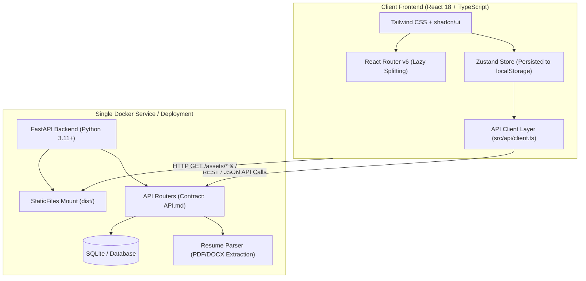

# HireSwift — Intelligent Multi-Tenant ATS for Growing Hiring Teams

**HireSwift** is a high-velocity Applicant Tracking System (ATS) tailored for hiring teams in India. Built with **React 18**, **TypeScript**, **Tailwind CSS**, and **Zustand**, HireSwift provides deep multi-tenancy, explainable match scoring against any Job Description, tri-state skill filtering (`AND` / `OR` / `NOT`), Kanban pipeline management with transition guardrails, 2-to-3 candidate comparisons, and seamless FastAPI integration.

---

## 🏛️ System Architecture



### FastAPI Static Serving & SPA Fallback
In production, HireSwift can be served directly by FastAPI from a single Docker container.

- **Vite Base URL**: Configured with `base: './'` so all script and stylesheet tags in `dist/index.html` use relative paths (`./assets/...`).
- **Client-Side Routing Fallback**: Single Page Applications (SPA) with deep links (e.g. `/app/pipeline`, `/app/candidates`) require the backend server to return `index.html` for any unmatched HTTP `GET` request.

Example FastAPI implementation:
```python
from fastapi import FastAPI
from fastapi.staticfiles import StaticFiles
from fastapi.responses import FileResponse
import os

app = FastAPI(title="HireSwift API")

# Mount API endpoints first
# app.include_router(api_router, prefix="/api")

# Mount built static assets
app.mount("/assets", StaticFiles(directory="dist/assets"), name="assets")

# SPA catch-all fallback
@app.get("/{full_path:path}")
async def serve_spa(full_path: str):
    file_path = os.path.join("dist", full_path)
    if os.path.exists(file_path) and os.path.isfile(file_path):
        return FileResponse(file_path)
    return FileResponse("dist/index.html")
```

---

## ⚡ Run Demo in 3 Minutes

Follow the step-by-step [DEMO_SCRIPT.md](file:///c:/Users/DELL/HireSwift/DEMO_SCRIPT.md) for a comprehensive walkthrough.

1. **Start the Frontend**:
   ```bash
   npm install
   npm run dev
   ```
2. **Access the ATS**: Open [http://localhost:5173/app/jobs](http://localhost:5173/app/jobs).
3. **Primary Recruiter Flow**:
   - **Upload Resumes**: Go to `/app/upload`, click **"Simulate 5 Resumes"** or **"⚡ Load 50 Test Candidates"**, and click **"Parse All Queued Resumes"**.
   - **Explainable Ranking**: Inspect match scores and the breakdown popover displaying matched skills (green `✓`) and missing skills (red `✕`).
   - **Smart Filters**: Go to `/app/candidates`, click `React` (AND), `Docker` (OR), or `Java` (NOT), and test `include_unknown`.
   - **Side-by-Side Compare**: Select 2 or 3 candidates and click **"Compare Selected"** (`/app/compare`) to view category winners.
   - **Kanban Moves**: Go to `/app/pipeline`, drag candidate cards between the 5 stages (**Applied**, **Shortlisted**, **Interview**, **Offer**, **Rejected**), observing transition validation.

---

## 📁 Test Data & Benchmark Assets

Located in `test-data/`:
- `test-data/resumes/`: 6 realistic sample resume text fixtures (Aditi Sharma, Rohan Verma, Ananya Iyer, Priya Patel, Vikram Singh, Rahul Nair).
- `test-data/jds/`: 3 markdown job descriptions (`full-stack-engineer.md`, `campus-graduate-trainee.md`, `python-data-engineer.md`).
- `test-data/answer_key.csv`: Benchmark ranking, expected score ranges, and explainability rationale.
- `test-data/demoDataLoader.ts`: 1-click dataset loader for evaluators.

---

## 🛠️ Verification & Quality Checks

Run the automated test and validation suite:

```bash
# Type check and lint (0 errors)
npm run lint

# Production bundle build (Route code-splitting, relative paths)
npm run build

# Unit tests (Scoring engine & multi-mode filter validation)
npm run test

# End-to-end tests (Playwright)
npm run test:e2e
```

---

## 🔑 Demo Login Accounts

| Tenant Workspace | Role | Email | Password | Primary Focus |
|---|---|---|---|---|
| **Nova Labs Pvt Ltd** | **Admin** | `admin@novalabs.com` | `demo123` | Lateral Experienced (Skills: 45%, Exp: 30%) |
| **Nova Labs Pvt Ltd** | **Recruiter** | `recruiter@novalabs.com` | `demo123` | Pipeline & email management |
| **Campus Hire Co** | **Admin** | `admin@campushire.com` | `demo123` | Campus Early Careers (CGPA cutoffs, Tier-1) |

---

## 🛡️ License
Built for fast-growing Indian hiring teams. Licensed under MIT.
